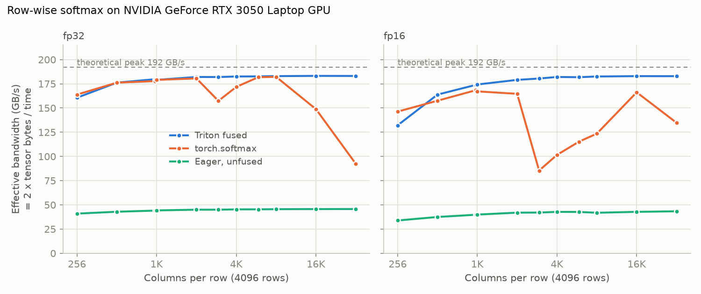

# Kernel worklog #1: fused softmax in Triton

A row-wise softmax written as a single fused Triton kernel, tested for numerical correctness in fp32 and fp16, and benchmarked against `torch.softmax` and an unfused PyTorch version. On an RTX 3050 Laptop GPU, it reaches **93–95% of theoretical DRAM bandwidth** for rows of 2,048 columns or more and runs **3.9–4.4x faster than the unfused version**.



## What fusion saves

Softmax over a row is `exp(x - max(x)) / sum(exp(x - max(x)))`. Written as separate PyTorch ops (`max`, subtract, `exp`, `sum`, divide), each op is its own kernel that reads its input from DRAM and writes its result back. For an M x N input that's about **5MN reads and 3MN writes** ([`naive_softmax`](kernels/softmax.py) has the per-op breakdown).

The fused kernel ([`kernels/softmax.py`](kernels/softmax.py)) gives each row to one Triton program. It loads the row from DRAM **once**, computes the max, the exponentials, the sum and the division entirely in registers, and stores the result **once**: MN reads and MN writes. That's 4x less memory traffic for the same math.

Implementation notes:
- **Numerical stability:** the row max is subtracted before `exp`, so every exponent is at most 0 and nothing overflows. The tests use inputs scaled by 1e4 (values in the tens of thousands) in both dtypes; without the max subtraction, `exp` would overflow, since fp32 `exp` overflows above about 88.7.
- **fp16:** values are loaded as fp16, computed in fp32 and stored as fp16.
- **Odd widths:** the block size is the row width rounded up to a power of two. Lanes past the end of the row are masked off and padded with `-inf`, which is neutral for `max` and contributes `exp(-inf) = 0` to the sum.
- **Strided input:** rows can have any stride (for example a column slice of a wider tensor). A non-contiguous last dimension is copied first.

## Results

RTX 3050 Laptop GPU (16 SMs, 4 GB GDDR6, 128-bit bus; 192 GB/s theoretical peak computed from the device's memory clock and bus width), driver 592.00, Windows 11 · torch 2.11.0+cu128, triton-windows 3.8.0.

The input is 4,096 rows at each width. Times are medians from `triton.testing.do_bench`. Effective bandwidth = 2 × tensor bytes / time, i.e. the minimum traffic of one read plus one write. Full sweep (11 widths × 2 dtypes): [`results/softmax_rtx3050_laptop.csv`](results/softmax_rtx3050_laptop.csv). Two full runs differed by at most 3.2% on any entry.

| dtype | Shape | Triton fused | torch.softmax | Eager, unfused | Fused vs eager |
|---|---|---|---|---|---|
| fp32 | 4096 x 256 | 0.052 ms, 161 GB/s (84%) | 0.051 ms, 164 GB/s (85%) | 0.205 ms, 41 GB/s (21%) | 3.9x |
| fp32 | 4096 x 1024 | 0.187 ms, 179 GB/s (93%) | 0.187 ms, 179 GB/s (93%) | 0.758 ms, 44 GB/s (23%) | 4.0x |
| fp32 | 4096 x 3000 | 0.540 ms, 182 GB/s (95%) | 0.625 ms, 157 GB/s (82%) | 2.184 ms, 45 GB/s (23%) | 4.0x |
| fp32 | 4096 x 4096 | 0.735 ms, 183 GB/s (95%) | 0.781 ms, 172 GB/s (89%) | 2.959 ms, 45 GB/s (24%) | 4.0x |
| fp32 | 4096 x 8192 | 1.467 ms, 183 GB/s (95%) | 1.474 ms, 182 GB/s (95%) | 5.895 ms, 46 GB/s (24%) | 4.0x |
| fp32 | 4096 x 16384 | 2.931 ms, 183 GB/s (95%) | 3.608 ms, 149 GB/s (77%) | 11.767 ms, 46 GB/s (24%) | 4.0x |
| fp32 | 4096 x 32768 | 5.864 ms, 183 GB/s (95%) | 11.625 ms, 92 GB/s (48%) | 23.489 ms, 46 GB/s (24%) | 4.0x |
| fp16 | 4096 x 256 | 0.032 ms, 132 GB/s (69%) | 0.029 ms, 146 GB/s (76%) | 0.124 ms, 34 GB/s (18%) | 3.9x |
| fp16 | 4096 x 1024 | 0.096 ms, 174 GB/s (91%) | 0.100 ms, 167 GB/s (87%) | 0.420 ms, 40 GB/s (21%) | 4.4x |
| fp16 | 4096 x 3000 | 0.272 ms, 180 GB/s (94%) | 0.575 ms, 85 GB/s (44%) | 1.168 ms, 42 GB/s (22%) | 4.3x |
| fp16 | 4096 x 4096 | 0.369 ms, 182 GB/s (95%) | 0.660 ms, 102 GB/s (53%) | 1.570 ms, 43 GB/s (22%) | 4.3x |
| fp16 | 4096 x 8192 | 0.735 ms, 183 GB/s (95%) | 1.086 ms, 124 GB/s (64%) | 3.207 ms, 42 GB/s (22%) | 4.4x |
| fp16 | 4096 x 16384 | 1.467 ms, 183 GB/s (95%) | 1.615 ms, 166 GB/s (87%) | 6.274 ms, 43 GB/s (22%) | 4.3x |
| fp16 | 4096 x 32768 | 2.936 ms, 183 GB/s (95%) | 3.983 ms, 135 GB/s (70%) | 12.383 ms, 43 GB/s (23%) | 4.2x |

## Why it's faster: roofline reasoning

Softmax does only a handful of operations per element (a compare for the max, a subtract, an `exp`, an add, a divide) against 8 bytes of traffic per element in fp32 (4 read, 4 written). That's an arithmetic intensity of well under 1 FLOP/byte. This GPU's FP32 peak is about 6.1 TFLOPS (16 SMs × 128 FP32 lanes × 2 FLOP per FMA × the 1.5 GHz clock the driver reports), which sets its compute/bandwidth "ridge point" near 32 FLOP/byte, so softmax sits deep in the memory-bound region. Run time is therefore set by bytes moved divided by bandwidth: the fused kernel moves the minimum and runs at 93–95% of peak, so there's almost nothing left to gain on this GPU. The unfused version shows up at about 23% "effective" bandwidth, but it moves about 4x as many bytes. Its real traffic is roughly 4 × 45 ≈ 180 GB/s, so it's also bandwidth-bound and simply does 4x the work, which is exactly the 3.9–4.4x gap in the table.

Other observations:
- **`torch.softmax` is also a fused kernel** and matches Triton at many widths. At some widths it reaches much less bandwidth, for example fp32 × 32,768 (48% of peak, 2.0x slower than Triton) and fp16 × 3,000–8,192 (44–64%). I haven't profiled which of PyTorch's softmax implementations runs at each width.
- **Narrow fp16 rows (256 columns)** are the one case where Triton is slower (69% vs 76% of peak). Each of the 4,096 programs moves only 1 KB, so per-program overhead dominates. Processing several rows per program would be the fix.

## Correctness tests

`pytest` runs 32 tests, all passing on this GPU. Every output is compared against `torch.softmax` computed in **float64**, with `torch.allclose` tolerances chosen per dtype:

| dtype | rtol | atol | Why |
|---|---|---|---|
| fp32 | 1e-5 | 1e-6 | computed and stored in fp32: a few ulps of error |
| fp16 | 1e-3 | 1e-5 | rounding to fp16 on store is up to 2^-11 ≈ 4.9e-4 relative; atol covers fp16 subnormal outputs |

Cases covered, each in fp32 and fp16 unless noted:
- **Shapes:** 1x1, 1x7, 1x1000, 3x781 (non-power-of-2), 128x1000, 4096x1024, 17x1823, 5x65536, 2x131072.
- **Large values:** inputs scaled by 1e2 and 1e4, which overflow `exp` without the max subtraction. Checks that every output is finite and that each row sums to 1.
- **Edge inputs:** constant rows (must be exactly uniform); attention-style `-inf` masking (masked entries must be exactly 0).
- **Layout (fp32):** strided rows, a transposed input and a 3D input.
- **Baseline:** the unfused baseline itself, so the comparison is fair.

To check that the tests can actually fail, I broke the kernel on purpose. Removing the max subtraction fails 6 tests (the large-value ones); padding masked lanes with 0 instead of `-inf` fails 15.

## Run it

```bash
pip install -r requirements.txt   # Linux: triton; Windows: triton-windows
pytest -q
python bench/bench_softmax.py --out results/softmax.csv --plot docs/softmax_bandwidth.png
```

No local GPU? Open [`notebooks/softmax_colab.ipynb`](notebooks/softmax_colab.ipynb) in Colab with a GPU runtime. It clones the repo, runs the tests and the benchmark, and shows the table and plot. The notebook hasn't been run on Colab yet; all numbers above are from the local RTX 3050.

## Next

- Handle rows wider than what fits in registers with an online-softmax loop (running max and sum), as used in FlashAttention.
- Process several narrow rows per program to close the gap at 256 columns.
- Profile with Nsight Compute to confirm DRAM throughput directly instead of inferring it from time.
